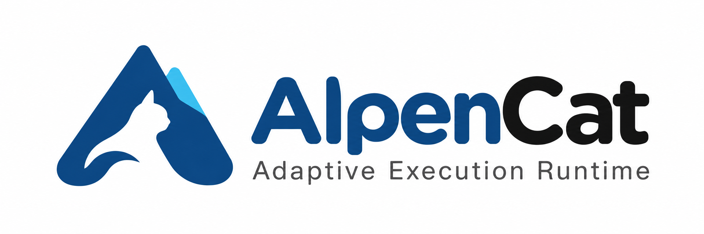
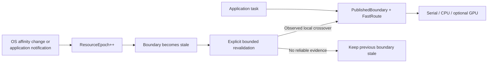
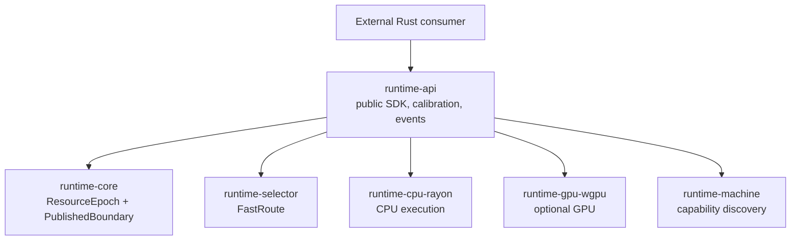

<p align="center"></p>

# AlpenCat

**An experimental, lightweight Rust execution runtime that maintains a calibrated routing boundary as available compute changes.**

**Latest tagged source:** [v0.4.0-alpha](https://github.com/Johnny-Kao/AlpenCat/releases/tag/v0.4.0-alpha) · **Status:** experimental alpha, not production certified · **Toolchain:** Rust 1.87+ · **License:** MIT OR Apache-2.0.

AlpenCat is **not** a general scheduler, telemetry engine, or online performance predictor. It separates low-overhead routing from bounded, explicitly requested measurement and resource-state notifications.

## How it works



**No automatic background recalibration is promised.** The application can call initial `calibrate_elapsed_map` and, after resource invalidation, `revalidate_elapsed_map`. Measurement evidence is local and workload-specific. Linux has an optional process-affinity observer; on other platforms applications can signal changes using `ResourceNotifier`. Native Intel HFI/AMD CPPC event delivery remains an open research target.

## Getting started

The repository is a Rust workspace. From a checkout containing the v0.4 alpha source:

```bash
cargo test -p runtime-api
cargo run -p runtime-api --example elapsed_sdk
cargo run -p runtime-api --example universal_quickstart
cargo run --manifest-path tests/external-consumer/Cargo.toml
```

For a **separate Rust project**, use the tagged source dependency:

```toml
[dependencies]
runtime-api = { git = "https://github.com/Johnny-Kao/AlpenCat", tag = "v0.4.0-alpha" }
```

For a concrete standalone application see [tests/external-consumer](tests/external-consumer/). It calls public APIs, verifies results before and after notification, and exercises calibration/revalidation. The Rust workspace package version remains `0.1.0`; the `v0.4.0-alpha` Git tag identifies a **source release**, not a published `0.4.0` crate.

## Runtime architecture



| Path | What it contains |
| --- | --- |
| `crates/` | Six active runtime crates |
| `crates/runtime-api/examples/` | Runnable SDK and research examples |
| `crates/runtime-api/tests/` | Integration, calibration, event and concurrency regression tests |
| `tests/external-consumer/` | Independent Cargo project (not a main-workspace member) |
| `benchmarks/` | Runtime hot-path and boundary-cost benchmarks |
| `experiments/` | Research and evidence analyzers, including historical experiments |
| `tools/native-validation/` | Passive hardware/OS validation utilities |
| `docs/` | Architecture, release notes, test evidence, roadmap and historical research |
| `.github/workflows/` | Release gates and supporting experimental workflows |

## Release and validation status

**v0.4.0-alpha is signed off for its documented experimental scope** at commit `f775b528dca13024c915bcde698f7fafa04e7f5d`:

- [Five-platform integration gate — PASS](https://github.com/Johnny-Kao/AlpenCat/actions/runs/38575886948): Linux x64/ARM64, macOS Apple Silicon/Intel, Windows x64. Includes independent SDK consumer and concurrent stress.
- [Convergence Smoke — PASS](https://github.com/Johnny-Kao/AlpenCat/actions/runs/38575887316): Rust checks and economic evidence workflow, at the same commit.
- [v0.4 release](https://github.com/Johnny-Kao/AlpenCat/releases/tag/v0.4.0-alpha) · [v0.1 preview](https://github.com/Johnny-Kao/AlpenCat/releases/tag/v0.1.0-preview)

The research branch can contain documentation or work beyond the tagged alpha; passing historical CI does **not** automatically validate later commits. Platform CI shows portable correctness on those runners, not generic performance superiority or native hardware notification support.

## Documentation

| Topic | Link |
| --- | --- |
| Main documentation navigation | [Docs index](docs/INDEX.md) |
| Component boundaries and event lifecycle | [Architecture](docs/ARCHITECTURE.md) |
| Version history and source dependency | [Release notes](docs/RELEASE_NOTES.md) |
| Tested revisions, job inventory and limitations | [Test evidence](docs/TEST_EVIDENCE.md) |
| Current status and future milestone criteria | [Roadmap](docs/ROADMAP.md) |
| Frozen alpha release decision | [v0.4 sign-off](docs/UNIVERSAL_V0_4_SIGNOFF.md) |
| Vendor-native validation approach | [Native validation](docs/NATIVE_VALIDATION.md) |
| Older experiments and falsified approaches | [Historical validation](docs/VALIDATION_STATUS.md) |

## Project principles

Correctness and reliable fallback first; bounded and explicit calibration rather than unbounded global inference; no background hot-path telemetry. Native vendor-specific event integration and production-readiness claims require independent physical-hardware and workload evidence.

The dated research reports remain available because negative and inconclusive experiments matter. No historical experiments or evidence scripts were deleted in the documentation reorganization.

## Contributing and license

See [Contributing](.github/CONTRIBUTING.md), [Security](.github/SECURITY.md), [MIT license](LICENSE-MIT), and [Apache-2.0 license](LICENSE-APACHE).
