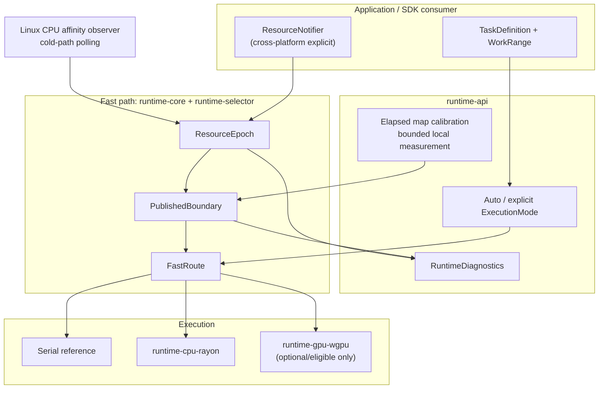
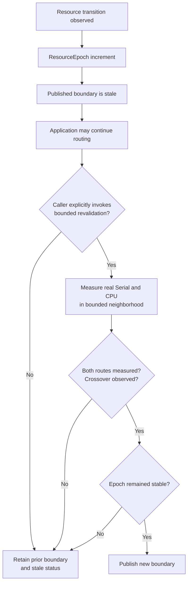

# AlpenCat architecture

**Current architecture:** v0.4.0-alpha, released 2026-10-14. Experimental. [Version notes](RELEASE_NOTES.md) · [Test evidence](TEST_EVIDENCE.md).

## Purpose

AlpenCat keeps a previously measured Serial/CPU execution boundary usable across changes in available compute. It separates the **fast routing path** from the **cold measurement and invalidation path**. It is not an end-to-end task scheduler, resource broker, or continuously learning model.

## Runtime components

## Resource transition and boundary validation

**Important:** revalidation is currently **explicit**, not an automatic background trigger caused by every routed task. A stale boundary does not itself schedule a measurement. Initial calibration is also explicitly invoked. The Linux observer observes process affinity, **not** Intel HFI/AMD CPPC. Use the portable explicit notifier when no supported observer exists.

**Evidence stays local.** No local crossover does not justify extrapolating a global serial-only route. Invalidated measurements cannot be used as current evidence.

## Crate responsibilities

| Crate | Purpose |
| --- | --- |
| `runtime-core` | Monotonic epoch, published boundary and work primitives |
| `runtime-selector` | FastRoute decision using the published boundary |
| `runtime-api` | Public tasks, dispatch, calibration, notifier and diagnostics |
| `runtime-cpu-rayon` | CPU parallel execution and resource-budget behavior |
| `runtime-gpu-wgpu` | Optional GPU execution where available |
| `runtime-machine` | Machine capability discovery |

`tests/external-consumer` is deliberately outside the main workspace to validate dependency usage.

## Stable invariants and limitations

- FastRoute is not responsible for probing, calibration or event polling.
- Caller-provided deterministic work is needed for comparable elapsed-map measurements.
- Unavailable CPU paths are not treated as valid timing data.
- No claim is made that any universal threshold generalizes across machines.
- v0.x API compatibility is not guaranteed; the Cargo workspace version remains 0.1.0 despite the v0.4 Git alpha tag.
- Hardware-native HFI/CPPC integration, production deployment and broad performance improvements are research items.

## Historical architecture research

Prior continuous telemetry, planners, brokers, policy caches and migration components were removed from the active design. The original work is recoverable from Git history and the `archive/pre-runtime-pruning-2026-10-04` branch. Dated documents under `docs/` and scripts under `experiments/` are kept as historical evidence rather than silently rewritten.

For chronological research findings, use [Validation Status](VALIDATION_STATUS.md). For released v0.4 evidence, use [Test Evidence](TEST_EVIDENCE.md).
