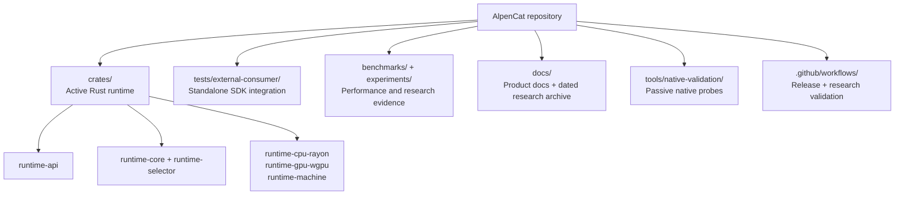

# Repository structure and maintenance policy

This is a navigation map for the **v0.4 alpha research branch**. The v0.4 tagged release itself remains pinned to commit `f775b528`. A post-tag documentation change does not silently amend that release.

## Directories

| Area | Policy | Where to start |
| --- | --- | --- |
| Production-shaped active implementation | Retain six active crates, preserve hot-path contract | [Architecture](ARCHITECTURE.md) |
| Public SDK contract | Test standalone integration, explicitly pin git release | [README](../README.md), `tests/external-consumer` |
| Release evidence | Link exact SHA and immutable historical Actions run URLs | [Test evidence](TEST_EVIDENCE.md) |
| Versions | Maintain separate source tag and Cargo-version explanations | [Release notes](RELEASE_NOTES.md) |
| Future scope | Gate future features on reproducible evidence | [Roadmap](ROADMAP.md) |
| Historical research | Preserve original dated documents and experiments; avoid rewriting outcomes | [Historical validation](VALIDATION_STATUS.md) |

## Workflow inventory: active vs supporting

**Release blockers for v0.4 alpha** (same SHA required):
- `.github/workflows/universal-v04-integration-gate.yml`
- `.github/workflows/convergence-smoke.yml`

**Foundation and universal validation** (supporting evidence, not a substitute for the release gates):
- `foundation-stability-gate.yml`
- `universal-v0_1-preview-gate.yml`
- `universal-cross-machine.yml`, `universal-e2e-baseline.yml`
- `runtime-framework-check.yml`, `robustness-matrix.yml`

**Hardware/OS integration and specialist research** (run as relevant, not automatically part of a release claim):
- `linux-real-os-runtime-e2e.yml`, `native-integration-broad-batch.yml`
- `native-probe-research-gate.yml`, `native-validation-probe.yml`
- `linux-x86-adaptive-batch.yml`, `linux-x86-paired-economics.yml`
- `x64-boundary-economics.yml`, `x64-hotpath-overhead.yml`

**Economic falsification/analysis research**:
- `boundary-validity-evidence.yml`, `switching-economics.yml`
- `w2-holdout.yml`, `w2-replication.yml`, `w3-mixed.yml`

Retain these workflows for reproducibility. A successful historical job only establishes the experiment it actually ran, not support for a future version.

## What was intentionally not moved/deleted

- Dated `docs/*.md` research checkpoints: referenced by prior experiments and handoffs.
- Historical `experiments/` analysis code and workflows: negative findings and comparisons remain auditable.
- Previously removed runtime layers: kept in Git history and archive branch, **not** restored.
- Git tags `v0.1.0-preview` and `v0.4.0-alpha`: untouched by documentation housekeeping.

## Documentation maintenance rules

1. Update `README.md` only for current entrypoint and core claims.
2. Put technical diagrams into `ARCHITECTURE.md`; keep Mermaid descriptive, not a substitute for code tests.
3. Put exact CI URLs, job matrices and measurement scope into `TEST_EVIDENCE.md`.
4. Keep `RELEASE_NOTES.md` factual and version-pinned; do not imply a post-tag documentation commit belongs to a released tag.
5. Keep future commitments and explicit non-goals in `ROADMAP.md`.
6. Avoid renaming historical paths without comprehensive inbound-link validation.
7. For new release claims, rerun both blocker workflows on one exact SHA and record their conclusions.
