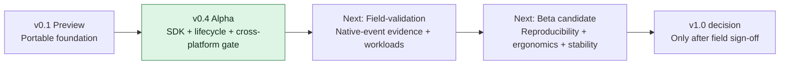
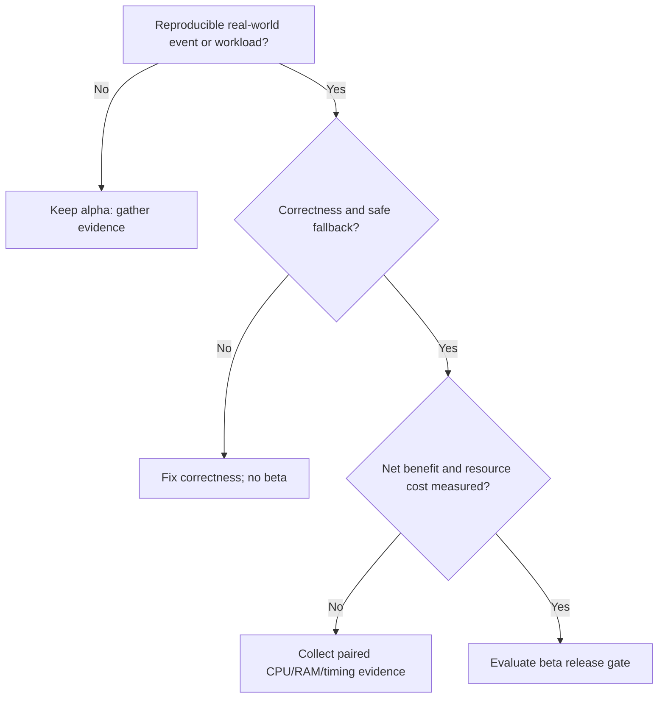

# AlpenCat roadmap

Version numbers describe **scope**, not a promise of universal performance improvement. AlpenCat is an experimental runtime, not a general scheduler.

## Completed

- **v0.1 Preview:** boundary and epoch primitives, portable fast route, explicit invalidation, bounded local revalidation with supplied measurements.
- **v0.4 Alpha (2026-10-14):** initial measured calibration, revalidation helpers, portable notifier and diagnostics, Linux affinity observer, independent consumer, concurrent stress and five-platform integration gate. [Release](https://github.com/Johnny-Kao/AlpenCat/releases/tag/v0.4.0-alpha).

## v0.5 research: active (not released)

- Adaptation economics screening: [research protocol](research/V0_5_ADAPTATION_ECONOMICS.md), [Linux x86 matrix run #38583433407](https://github.com/Johnny-Kao/AlpenCat/actions/runs/38583433407). Four matrix jobs PASS; initial decision **ITERATE** due inconsistent W3 economics and measurement-design limits. This is not a v0.5 performance sign-off.
- Gate before a positive performance claim: same-process lifecycle measurement, interleaved randomized paired baselines, actual calibration and recovery costs, per-mode CPU/RSS, statistically defensible repeats and measured regressions.
- Retain negative findings. Do not optimize routing based solely on this preliminary benchmark or promote alpha to beta.

## Next milestones (not shipped)

| Priority | Milestone | Exit condition |
| --- | --- | --- |
| P0 | Documentation/SDK ergonomics | Public usage contract, supported-platform fallbacks and limitation examples remain internally consistent; documentation link checks pass |
| P1 | Native hardware event research | Confirm a supported OS event path on real host; record signal provenance and end-to-end epoch effect; no conflation with polling |
| P1 | Field workload economics | Reproducible paired Serial / CPU / Auto latency and CPU/RAM measurements on representative workloads, with confidence intervals and honest regressions |
| P1 | Resilience / lifecycle | Longer-running workload stress, cancellation/recovery and resource-failure behavior under constrained machines |
| P2 | SDK beta readiness | External-user feedback, compatibility contract, packaging/version policy and reproducible release workflow |
| P3 | Production / v1.0 consideration | Independent evidence on hardware and workloads plus a reviewed support/security plan |

## Decision tree for the next version

## Explicitly deferred

Native Intel HFI/AMD CPPC support until verified kernel/OS interfaces are available; generic workload-specific auto-policy tuning without representative evidence; full scheduler redesign; crates.io publication until a packaging decision. Research records remain preserved under `docs/` and `experiments/`.

See [Test Evidence](TEST_EVIDENCE.md) and [Release Notes](RELEASE_NOTES.md) before interpreting version status.
