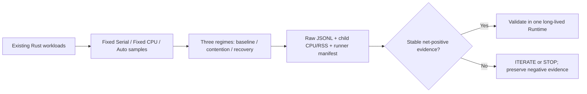

# v0.5 — Adaptation Economics (screening)

**Status:** EXPERIMENT RUNNING / decision pending. Not a v0.5 release.

## Hypothesis
For repeated workload mixes, the cumulative savings of explicitly calibrated Auto over the *best fixed mode for the whole mix* exceed calibration/revalidation costs before the resource regime changes again.

## Methodology
- Reuse the existing `evidence_workload` (CPU), `evidence_memory_workload` (memory) and `evidence_mixed_workload` (mixed compute/gather) Rust examples.
- Three sequential regimes per runner: baseline → external CPU contention → recovery.
- Same runner and workload inputs for Serial, CPU and Auto. Five repetitions, raw JSONL samples and CPU/RSS process accounting archived.
- Linux x86 only, Ubuntu 22.04 and 24.04 runners, two independent samples. Cross-runner absolute timing comparisons are prohibited.
- For each regime, compare summed median per-size latency of Auto to the faster *globally fixed* Serial or CPU strategy.
- Estimated adaptation net over N repetitions of the measured size sweep: `N × (min(fixed_serial, fixed_cpu) − Auto) − measured_adaptation_cost`; positive values are estimates, not demonstrated sustained throughput.
- Preserve backend selections, publication result, stale boundary and output parity.

## Limitations and falsification controls
1. Existing examples measure fixed routes before Auto: comparisons are NOT fully randomized three-way AB/BA pairings. The CPU-only evidence example also does not interleave fixed routes. Order/time drift may bias results.
2. Bootstrap mode uses an offline sweep to publish its boundary. Its *estimated* bootstrap overhead is not a measured end-to-end call to public `calibrate_elapsed_map`. This is only screening economics.
3. Each regime launches a new process and passes the prior boundary value, not an identical long-lived Runtime instance. Epoch transitions and recovery are only simulated at the boundary level; actual within-process epoch/fallback lifecycle and adaptation scheduling must be separately verified.
4. `/usr/bin/time` CPU and peak child RSS cover the entire benchmark process, including fixed-route probing and Auto; they cannot be attributed to Auto alone.
5. Three environments across potentially shared GitHub hosted hosts do not prove genuine production performance or reproducibility on specific physical Intel/AMD CPUs. No cgroup memory cap or real OS affinity transition in this screening.
6. p99 cannot be estimated reliably from five repetitions. The output preserves raw samples for later inspection, without claiming confidence intervals.
7. No automatic background adaptation is implied. Negative/zero savings and fallback remain valid findings.

## Decision
**PENDING evidence.** A green GitHub Actions run means code and parity checks completed; it is **not** an economic GO. Assess gross savings, amortization period, noise, CPU/RSS and adverse regimes before GO / ITERATE / STOP.

## Next actions
If positive economics survive screening, run a single long-lived-runtime paired lifecycle measurement with truly interleaved Serial/CPU/Auto, actual measured calibration/revalidation, affinity reduction/recovery, complete per-mode CPU/RSS and sufficient repetitions for CI. Otherwise STOP or ITERATE according to observed failure mode.

## Test architecture

