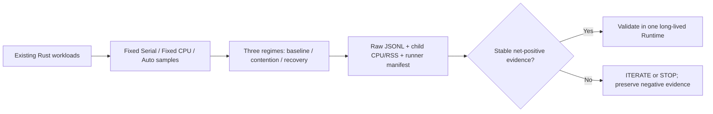

# v0.5 — Adaptation Economics (screening)

**Status:** INITIAL SCREENING COMPLETED — ITERATE. Not a v0.5 release.\n\n**Execution:** [Actions run #38583433407](https://github.com/Johnny-Kao/AlpenCat/actions/runs/38583433407), SHA `7b5a794cd4eeb7f07e70b7fc9960e933b4d1a4e2`; all 4 Linux x86 matrix jobs PASS. Raw samples, manifests, and CPU/RSS are attached to the run.

## Hypothesis
For repeated workload mixes, the cumulative savings of explicitly calibrated Auto over the *best fixed mode for the whole mix* exceed calibration/revalidation costs before the resource regime changes again.

## Methodology
- Reuse the existing `evidence_workload` (CPU), `evidence_memory_workload` (memory) and `evidence_mixed_workload` (mixed compute/gather) Rust examples.
- Three sequential regimes per runner: baseline → external CPU contention → recovery.
- Same runner and workload inputs for Serial, CPU and Auto. Five repetitions, raw JSONL samples and CPU/RSS process accounting archived.
- Linux x86 only, Ubuntu 22.04 and 24.04 runners, two independent samples. Cross-runner absolute timing comparisons are prohibited.
- For each regime, compare summed median per-size latency of Auto to the faster *globally fixed* Serial or CPU strategy.
- Estimated adaptation net over N repetitions of the measured size sweep: `N × (min(fixed_serial, fixed_cpu) − Auto) − measured_adaptation_cost`; positive values are estimates, not demonstrated sustained throughput.
- Preserve backend selections, publication result, stale boundary and output parity.

## Limitations and falsification controls
1. Existing examples measure fixed routes before Auto: comparisons are NOT fully randomized three-way AB/BA pairings. The CPU-only evidence example also does not interleave fixed routes. Order/time drift may bias results.
2. Bootstrap mode uses an offline sweep to publish its boundary. Its *estimated* bootstrap overhead is not a measured end-to-end call to public `calibrate_elapsed_map`. This is only screening economics.
3. Each regime launches a new process and passes the prior boundary value, not an identical long-lived Runtime instance. Epoch transitions and recovery are only simulated at the boundary level; actual within-process epoch/fallback lifecycle and adaptation scheduling must be separately verified.
4. `/usr/bin/time` CPU and peak child RSS cover the entire benchmark process, including fixed-route probing and Auto; they cannot be attributed to Auto alone.
5. Three environments across potentially shared GitHub hosted hosts do not prove genuine production performance or reproducibility on specific physical Intel/AMD CPUs. No cgroup memory cap or real OS affinity transition in this screening.
6. p99 cannot be estimated reliably from five repetitions. The output preserves raw samples for later inspection, without claiming confidence intervals.
7. No automatic background adaptation is implied. Negative/zero savings and fallback remain valid findings.

## Decision
**ITERATE (research methodology, not runtime tuning).** Four green jobs confirm executable screening/parity; they do not prove a stable net performance benefit. W1 shows small positive gross savings across all samples but baseline 100-cycle net was negative in all four; W2 has one baseline regression and positive pressure savings; W3 has baseline and contention sign reversals. No universal economic GO. See observed data below.

## Next actions
If positive economics survive screening, run a single long-lived-runtime paired lifecycle measurement with truly interleaved Serial/CPU/Auto, actual measured calibration/revalidation, affinity reduction/recovery, complete per-mode CPU/RSS and sufficient repetitions for CI. Otherwise STOP or ITERATE according to observed failure mode.

## Test architecture

## First integrated run: observed results

Same-run *per full size sweep* gross Auto savings relative to the best fixed strategy, milliseconds; negative values are regressions. Columns are phases; each cell reports W1 / W2 / W3. These are descriptive medians, **not** estimates with confidence intervals.

| Runner/sample | Baseline (ms) | CPU contention (ms) | Recovery (ms) |
| --- | --- | --- | --- |
| Ubuntu 22.04 / 1 | +0.123 / +0.137 / −1.709 | +0.066 / +0.176 / +32.507 | +0.075 / +0.081 / +5.997 |
| Ubuntu 22.04 / 2 | +0.166 / +0.308 / +10.423 | +0.319 / +1.387 / +1.974 | +0.191 / +0.411 / −2.257 |
| Ubuntu 24.04 / 1 | +0.279 / −0.338 / −0.822 | +0.447 / +0.897 / −14.932 | +0.163 / +0.358 / +3.277 |
| Ubuntu 24.04 / 2 | +0.158 / +0.547 / −11.432 | +0.989 / +1.133 / +19.233 | +0.032 / +0.209 / +2.215 |

### Economics and resources

- Baseline W1 net over a *hypothetical* 100 size-sweep cycles was negative in 4/4, chiefly because of startup/bootstrap cost (approximately 27–38 ms in samples), against <0.28 ms gross savings per cycle.
- Baseline W2 gross savings reversed sign on Ubuntu 24.04 sample 1; this refutes stable superiority at current measurement precision.
- W3 sign reversed across samples for baseline (3/4 negative), CPU contention (1/4 negative), and recovery (1/4 negative). The contention swing is large enough to demand randomized paired remeasurement before interpreting it as resource-aware gain.
- All four samples reported output equivalence and successful explicit revalidation status under CPU pressure and recovery; all workload processes completed.
- Observed entire benchmark-process CPU time for W1 was roughly 0.33–0.48 seconds, W2 0.24–0.32 seconds, W3 10.85–20.71 seconds. Peak child RSS across samples was roughly 4.6–6.3 MiB (W1), 91–108 MiB (W2), and 92–108 MiB (W3). This **cannot** establish an Auto-specific resource advantage because fixed-route runs and probing are included.
- No robust p99, noise-floor estimate, or confidence interval is claimed from five samples per point. The four jobs can execute on different virtualized CPU hosts.

### Follow-up gate

1. Keep the three Rust workloads, but replace the current staged route measurement with *actual within-process, randomized/interleaved* Serial, CPU, Auto calls for matched size sequences and checksums. Compare startup + explicit calibration and changes/recovery in the same Runtime instance.
2. Record per-mode CPU time and RSS (or process-delta with limitations), thermal/noise context, and enough paired repetitions to estimate intervals and regression frequency.
3. Distinguish dispatch/scheduling costs from calibration/revalidation and distinguish global fixed-best from per-size oracle best. Test low call counts and frequent resource flips.
4. If W3 sign reversals persist after controls, isolate environmental effects and route crossover behavior; stop any proposed blanket performance claim.

No algorithm parameter changes are justified by this first screening.

## Resource–Action–Opportunity experiment (following architectural audit)

The archived [Convergence Research Plan](../CONVERGENCE_RESEARCH_PLAN_2026-10-06.md), [Generic STOP decision](../UNIVERSAL_GENERIC_HOLDOUT_DECISION_2026-10-08.md) and [Linux x86 specialization checkpoint](../LINUX_X86_SPECIALIZATION_CHECKPOINT_2026-10-08.md) override any interpretation that the objective is simply to maximize Generic Auto scores.

The next experiment is [resource_action_matrix.py](../../experiments/v05/resource_action_matrix.py), executed by [v05-resource-action-matrix.yml](../../.github/workflows/v05-resource-action-matrix.yml). It records an actual *effective schedulable CPU set* alongside cgroup CPU quota, cgroup memory limits, PSI and a runner manifest, then constrains child workloads to up to 4, 2 and 1 permitted CPUs and returns to the original envelope.

The *controllable action space of the existing SDK* is Serial vs CPU parallel within its runtime execution budget. External affinity manipulation is the experiment's intervention and **not** an SDK action. The analyzer reports fixed-best / per-size oracle / observed Auto: \(fixed-best − oracle\) is the maximum *measured actionable* opportunity across the observed sizes, subject to measurement noise. A zero or negative Auto result must be distinguished from a zero oracle opportunity.

**Limits:** existing Rust examples execute fixed modes before Auto and measure bootstrap cost indirectly; repeated subprocesses are not a single long-lived SDK lifecycle. Child CPU-time and peak RSS cover mixed fixed + Auto measurements, so there is no valid per-action memory-efficiency attribution. The run is a falsification/screening gate, not a full control-policy economic claim. GPU and memory batch-size actions remain future research; do not infer they are presently controllable from their hardware snapshots.

**Decision after matrix:** If oracle opportunity is absent, STOP optimizing that workload; if opportunity exists but Auto misses it, examine platform-signal/action eligibility before any tuning; if signal economics fail, STOP the candidate policy. Do not reopen the frozen Generic optimizer campaign.

## Resource–Action Matrix: first result (2026-10-14)

**Run:** [#38585542540](https://github.com/Johnny-Kao/AlpenCat/actions/runs/38585542540) — source SHA `ea56ca633e636593516982eb9794c07e7e16167a`, four of four Linux jobs PASS, raw matrix and environment artifacts retained. Three existing workload families were exercised in controlled CPU affinity 4 → 2 → 1 → 2 → 4 envelopes per job (where available). This is subprocess affinity control, not an SDK capability to change affinity.

**Decisive finding:** measured *per-size oracle opportunity* versus the best global fixed mode was frequently **tiny**, but measured Auto gains/losses were substantially larger. In particular W3 across Ubuntu 22.04 samples displayed oracle opportunities roughly 0.04–0.17 ms per sweep under affinity 2–4, while signed Auto differences reached about −41.8 to +88.5 ms. Ubuntu 24.04 likewise showed W3 signed differences from approximately −86.5 to +25.4 ms against about 0.17–0.18 ms of fixed-vs-oracle opportunity. These contradictory magnitudes are strong evidence of order/time drift or uncontrolled measurement disturbance; they **cannot** represent a repeatable routing benefit.

At affinity 1, CPU fallback to Serial and zero measured per-size oracle opportunity were observed, consistent with the existing effective parallelism guardrail. Some observed Auto-vs-fixed differences remained nonzero even there: another direct demonstration of timing noise rather than meaningful action advantage.

**Control-level interpretation:**
- Effective schedulable CPU availability is measurable and can be manipulated in the experiment, and the runtime conservatively falls back to Serial at 1 CPU.
- Distinguish capability constraints from workload route-economics. Detecting fewer effective CPUs is useful for exclusion; it does not itself establish the value of recalibration.
- Existing evidence is insufficient to price platform-informed switches; no new Linux-specific policy should be merged.
- Important limitation: each envelope is a newly launched workload process, not a single Runtime whose ResourceEpoch genuinely spans 4 → 2 → 1 → 2 → 4. CPU-time/RSS are whole-process measurements, not per-action reductions. The existing benchmark's calibration bootstrap cost is estimated, not a real closed-loop adaptation measurement.

**Research decision: ITERATE methodology only; no Runtime tuning.** Require actual same-process paired/interleaved action measurement and an independently estimated noise floor, before proceeding from opportunity screening to Linux signal eligibility/policy. W3 performance claims are **blocked**. Generic STOP remains unchanged.

## Bias-control follow-up: same-runtime paired gate

[Run #38588802211](https://github.com/Johnny-Kao/AlpenCat/actions/runs/38588802211) at SHA `825c797e5a72664c92d6194d820e87b37f94e97b` checks formatting, builds and measures [v05_paired.rs](../../crates/runtime-api/examples/v05_paired.rs). A single Runtime per kernel type executes a *rotating-order* Serial/CPU/Auto block at each of four sizes, 21 measured blocks and 3 warmups. It measures real initial `calibrate_elapsed_map`, asserts full result-vector equivalence and records chosen CPU/Auto backend, paired signed difference and regression frequency.

**Limits:** CPU vs Auto comparisons are same-process and interleaved, but paired best-of-Serial/CPU each block is an optimistic per-block hindsight oracle, *not* the best deployable static policy. A positive result against that oracle should not be assumed; negative results are meaningful as screening only. Existing Synthetic kernels are not identical to legacy W1/W2/W3, so do not combine or pretend direct historical comparability. No affinity transition or revalidation lifecycle here. The controlled Resource–Action Matrix remains separate; these two experiments answer different portions of the required evidence.

**Gate:** Treat CI green as correct benchmark execution only. Economics can advance only if measured opportunity exceeds the observed fluctuation and complete lifecycle overhead; otherwise STOP/ITERATE without modifying the selector.
